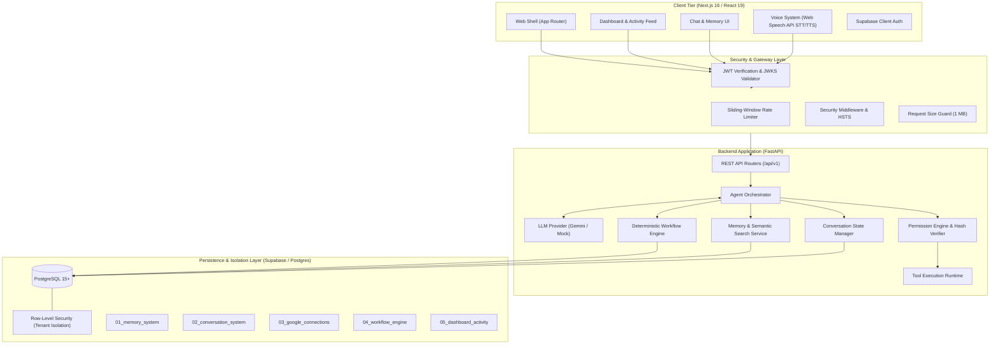

# ATLAS — Autonomous Task & Life Assistant System

> **Operating Cycle:** Understand → Plan → Authorize → Execute → Verify → Remember → Report<br/>
> **Security Invariant:** The LLM proposes. The system authorizes. The tools execute. The system verifies.

ATLAS is an enterprise-grade autonomous AI assistant and execution platform designed for reliable personal and operational task automation. Built with an asynchronous **FastAPI** backend, a responsive **Next.js/React** frontend, and **Supabase/PostgreSQL** with Row-Level Security (RLS), ATLAS combines structured reasoning with deterministic tool governance, persistent conversational memory, multi-step deterministic workflows, browser-native voice interaction, and real-time operational telemetry.

Unlike unconstrained chat agents that directly perform side effects, ATLAS strictly decouples LLM generation from execution: all actions require system authorization, user confirmation policies are strictly enforced, and every state mutation is verified before committing to memory or history.

---

## Table of Contents

- [A. Project Overview & Philosophy](#a-project-overview--philosophy)
- [B. Key Features](#b-key-features)
- [C. System Architecture](#c-system-architecture)
- [D. Technology Stack](#d-technology-stack)
- [E. Repository Structure](#e-repository-structure)
- [F. Prerequisites](#f-prerequisites)
- [G. Installation & Local Setup](#g-installation--local-setup)
- [H. Environment Configuration](#h-environment-configuration)
- [I. Testing & Evaluation Matrix](#i-testing--evaluation-matrix)
- [J. Security & Governance Model](#j-security--governance-model)
- [K. Implementation Roadmap & Status](#k-implementation-roadmap--status)
- [L. Known Limitations & Operator Runbook](#l-known-limitations--operator-runbook)
- [M. Contribution & Git Workflow](#m-contribution--git-workflow)
- [N. Deployment & Licensing](#n-deployment--licensing)

---

## A. Project Overview & Philosophy

Modern AI assistants often fail in production because they rely on fragile "hallucinate-then-act" patterns without strong guarantees or state tracking. ATLAS implements a rigorous seven-stage state cycle for every user interaction:

```
[User Request]
       │
       ▼
 1. UNDERSTAND ──> Parse intent, context, active conversation, and relevant episodic memory
       │
       ▼
 2. PLAN ────────> Propose structured step sequence and parameter bindings (LLM layer)
       │
       ▼
 3. AUTHORIZE ───> Evaluate action safety level, required confirmations, and user permissions
       │
       ▼
 4. EXECUTE ─────> Dispatch deterministic tool calls in sandboxed runtime (Tool Executor)
       │
       ▼
 5. VERIFY ──────> Validate execution outputs against schema invariants and postconditions
       │
       ▼
 6. REMEMBER ────> Persist interaction, facts, episodic memory, and state transitions
       │
       ▼
 7. REPORT ──────> Deliver verified outcome and telemetry back to the user
```

### The Security Invariant

> **The LLM proposes. The system authorizes. The tools execute. The system verifies.**

1. The LLM has zero direct access to network APIs, databases, shell commands, or external integrations.
2. The permission engine deterministically authorizes or rejects all proposed actions based on configured risk tiers (`read_only`, `requires_confirmation`, `critical`).
3. If an action requires confirmation, execution halts and computes a deterministic SHA-256 context integrity hash binding `user_id`, `workflow_id`, `step_id`, `tool_name`, and serialized arguments; the step transitions to `waiting_for_confirmation` and execution cannot proceed until the authenticated user explicitly confirms or rejects it.
4. Tools execute with structured input validation, granular timeouts, and sanitized output formatting.
5. Post-execution verification ensures errors or unexpected payloads are trapped before informing the user or persisting state.

---

## B. Key Features

Features are categorized into fully implemented offline-capable capabilities and configuration-dependent live services:

### Fully Implemented Core Platform
- **Multi-Turn Persistent Conversations:** Stateful chat history with thread management, search, soft deletion, and per-user isolation backed by PostgreSQL or fallback in-memory adapters.
- **Hierarchical Memory System:** Semantic, episodic, and working memory stores with recency decay, relevance scoring, and query filters.
- **Deterministic Workflow Engine:** Directed workflow execution supporting step dependencies, retries with backoff, conditional branch skipping, step-level rollbacks, and transaction-safe event streaming.
- **Operational Dashboard & Activity Feed:** Live metrics for workflows, pending confirmations, conversation counts, system health telemetry, and paginated audit event logs.
- **Permission & Safety Engine:** Multi-tiered authorization model with context-bound SHA-256 confirmation hashing, idempotency checks, and automated rejection of dangerous parameters.
- **Browser-Native Voice Interaction:** Speech-to-text (STT) and text-to-speech (TTS) built entirely on the W3C Web Speech API standard (`window.SpeechRecognition` and `window.speechSynthesis`) with zero external audio services, zero cloud audio streaming, and zero extra dependencies.
- **Security Hardening & Rate Limiting:** In-memory sliding-window rate limiters per route, reverse proxy trust boundaries, request body limits (1 MB), secure security headers (HSTS, X-Content-Type-Options, Frame Options), and credential log redaction.
- **Automated Reliability Evaluation Suite:** 36 automated evaluation scenarios covering safety, adversarial injection, memory retrieval, workflow execution, tool authorization, and critical safety invariants.

### Configuration-Dependent Integrations
- **Gemini LLM Provider:** Fully functional with Gemini 2.0 Flash when `GEMINI_API_KEY` is provided; uses high-fidelity synthetic mock providers in local tests and CI.
- **Supabase Cloud Persistence:** Fully authored and statically reviewed schema migrations with RLS policies; automated test suites run against in-memory adapters, requiring manual migration push for live PostgreSQL.
- **Google Workspace Integration:** OAuth2 authentication flow, Fernet-encrypted token storage, and Gmail/Calendar client wrappers implemented; live write execution is strictly disabled (`actions_enabled=False`) in safe dry-run mode until per-user production credentials are configured.
- **GitHub App Integration:** GitHub App private key authentication, installation token exchange, and issue/PR client implemented; write operations are strictly disabled (`actions_enabled=False`) in safe dry-run mode until enterprise app authorization is provisioned.

---

## C. System Architecture



### Security Boundary Architecture
1. **Unauthenticated Perimeter:** Requests pass through sliding-window rate limiters, request-size filters, and CORS validation before touching application logic.
2. **Authenticated Boundary:** The `get_current_user` dependency verifies Supabase JWTs via JWKS or asymmetric keys, extracting the user ID (`sub`).
3. **Database Tenant Isolation:** Database connections set transaction-local RLS claims (`SET LOCAL ROLE authenticated; SET LOCAL "request.jwt.claim.sub" = user_id; SET LOCAL "request.jwt.claim.atlas_backend" = 'true'`). Client-side Supabase keys cannot query backend tables directly.

---

## D. Technology Stack

| Layer | Component | Version | Rationale & Capabilities |
| :--- | :--- | :--- | :--- |
| **Backend** | Python | `3.12+` | Fully compatible with Python 3.12, 3.13, and 3.14. |
| | FastAPI | `0.142.2` | High-performance asynchronous API framework with OpenAPI schema generation. |
| | Pydantic Settings | `2.15.0` | Strongly-typed environment validation and configuration parsing. |
| | google-genai | `2.28.0` | Official Google GenAI SDK for Gemini 2.0 Flash integration. |
| | psycopg | `3.2.10` | Modern PostgreSQL driver supporting connection pooling and binary protocols. |
| | PyJWT | `2.10.1` | Asymmetric RSA/ECDSA JWKS token verification for Supabase authentication. |
| | Cryptography | `50.0.2` | Fernet symmetric token encryption for stored third-party OAuth credentials. |
| | Pytest | `9.1.1` | Comprehensive unit and integration test runner. |
| **Frontend** | Node.js | `22.x+` | Standard LTS runtime supporting experimental strip-types. |
| | Next.js | `16.4.0` | App Router frontend with React Server Components and standalone compilation. |
| | React & React DOM | `19.3.0` | Modern declarative UI library. |
| | @supabase/supabase-js | `2.117.3` | Browser-side client authentication and session state management. |
| | TypeScript | `5.x` | Strict type checking across all client interfaces. |
| | ESLint | `9.x` | Flat config linting with `eslint-config-next`. |
| **Database** | PostgreSQL | `15+` | Relational storage with JSONB indexing and Row-Level Security. |

---

## E. Repository Structure

```
ATLAS/
├── .github/
│   └── workflows/
│       └── ci.yml               # GitHub Actions CI matrix (Py 3.12/3.13, Node 22)
├── backend/
│   ├── app/
│   │   ├── agent/               # Agent orchestrator and prompt templates
│   │   ├── api/                 # REST routers (chat, workflows, dashboard, auth)
│   │   ├── config/              # Application settings and environment definitions
│   │   ├── conversations/       # Thread management, messages, and persistence
│   │   ├── core/                # Errors, exceptions, and global logging setup
│   │   ├── database/            # Database connection pools and RLS session helpers
│   │   ├── evaluation/          # 36 automated reliability evaluation test cases
│   │   ├── integrations/        # Google Workspace and GitHub App integrations
│   │   ├── memory/              # Semantic, episodic, and working memory engines
│   │   ├── security/            # Rate limiting, security headers, token auth
│   │   ├── services/            # Background job handlers and LLM abstraction
│   │   ├── tools/               # Sandboxed tool definitions and registry
│   │   └── workflows/           # Workflow engine, step DAG, and execution engine
│   ├── tests/                   # 219 automated unit and integration tests
│   └── requirements.txt         # Pinned backend dependencies
├── docs/                        # Technical architecture and domain guides
│   ├── authentication.md
│   ├── conversations.md
│   ├── dashboard_activity.md
│   ├── evaluations.md
│   ├── integrations.md
│   ├── memory.md
│   ├── security_hardening.md
│   ├── voice.md
│   └── workflows.md
├── frontend/
│   ├── app/                     # Next.js App Router (dashboard, chat, activity, etc.)
│   ├── components/              # Modular UI components (Chat, Voice, Activity)
│   ├── hooks/                   # React custom hooks (useVoice, etc.)
│   ├── public/                  # Static assets and icons
│   ├── scripts/                 # Voice system verification runner
│   ├── services/                # API client and Supabase browser client
│   ├── types/                   # Shared TypeScript interfaces
│   ├── package.json             # Pinned frontend dependencies
│   └── tsconfig.json            # Strict TypeScript configuration
├── reports/
│   ├── evaluations/             # JSON evaluation benchmarks and test outputs
│   └── release_readiness_report.md # Comprehensive release audit and runbook
├── scripts/
│   └── run_evals.py             # CLI runner for agent evaluation framework
├── supabase/
│   └── migrations/              # 5 immutable, audited PostgreSQL RLS migrations
├── .env.example                 # Root environment variable template
├── .gitignore                   # Standard multi-stack exclusion rules
└── README.md                    # Primary repository documentation
```

---

## F. Prerequisites

Before installing ATLAS, ensure the following runtimes and tools are installed:

- **Operating System:** Windows 10/11, macOS, or Linux.
- **Python:** Version `3.12` or higher (verified up to Python `3.14`).
- **Node.js:** Version `22.0.0` or higher (LTS recommended).
- **Package Managers:** `pip` (Python) and `npm` (Node.js).
- **Git:** Version `2.30+` for version control.
- **PostgreSQL / Supabase (Optional for local dev):** PostgreSQL 15+ or a Supabase cloud project for persistent database storage. If omitted, ATLAS runs cleanly with in-memory adapters.
- **Google Gemini API Key (Optional for local dev):** `GEMINI_API_KEY` for live generative inference. If omitted, the application falls back to synthetic mock providers.

---

## G. Installation & Local Setup

Follow these step-by-step instructions in Windows PowerShell (or standard Bash on Linux/macOS):

### 1. Clone the Repository
```powershell
git clone https://github.com/saad07072/ATLAS.git
cd ATLAS
```

### 2. Configure Backend Python Environment
```powershell
# Create a dedicated virtual environment
python -m venv backend\.venv

# Activate the virtual environment
# Windows PowerShell:
.\backend\.venv\Scripts\Activate.ps1
# Linux / macOS:
# source backend/.venv/bin/activate

# Upgrade pip and install pinned dependencies
python -m pip install --upgrade pip
pip install -r backend\requirements.txt
```

### 3. Configure Frontend Node Environment
```powershell
cd frontend
npm ci
cd ..
```

### 4. Setup Environment Files
```powershell
# Copy template configuration files
Copy-Item .env.example backend\.env
Copy-Item frontend\.env.example frontend\.env.local
```

### 5. Start Development Servers

**Terminal 1 — Backend API Server:**
```powershell
.\backend\.venv\Scripts\Activate.ps1
python -m uvicorn backend.app.main:app --host 127.0.0.1 --port 8001 --reload
```
The FastAPI backend will start at `http://127.0.0.1:8001`. Interactive OpenAPI documentation is available at `http://127.0.0.1:8001/docs`.

**Terminal 2 — Frontend Application:**
```powershell
cd frontend
npm run dev
```
The Next.js frontend will start at `http://localhost:3000`.

---

## H. Environment Configuration

All environment variables are declared in `.env.example`. Never commit active API keys, secrets, or database credentials to version control.

| Variable | Required | Default | Description |
| :--- | :---: | :---: | :--- |
| `GEMINI_API_KEY` | Optional | `None` | Google GenAI API key for Gemini 2.0 Flash. If omitted, mock provider is used. |
| `LLM_PROVIDER` | No | `gemini` | Active LLM driver (`gemini` or `mock`). |
| `DATABASE_URL` | Optional | `None` | PostgreSQL connection URI for Supabase database. If omitted, in-memory repository adapters are used. |
| `SUPABASE_URL` | Optional | `None` | Supabase API endpoint (e.g., `https://xyz.supabase.co`). |
| `SUPABASE_JWT_SECRET` | Optional | `None` | Secret/public key for verifying Supabase JWT signatures. |
| `GOOGLE_OAUTH_CLIENT_ID` | Optional | `None` | Google OAuth2 Client ID for Workspace integrations. |
| `GOOGLE_OAUTH_CLIENT_SECRET` | Optional | `None` | Google OAuth2 Client Secret. |
| `GOOGLE_OAUTH_REDIRECT_URI` | No | `http://127.0.0.1:8001/api/v1/google/oauth/callback` | OAuth redirect URI. |
| `GOOGLE_TOKEN_ENCRYPTION_KEY`| Optional | `None` | 32-byte URL-safe base64 key for Fernet credential encryption. |
| `GITHUB_APP_ID` | Optional | `None` | GitHub Application ID. |
| `GITHUB_INSTALLATION_ID` | Optional | `None` | GitHub App Installation ID. |
| `GITHUB_PRIVATE_KEY_PATH` | Optional | `None` | File path to GitHub App PEM private key. |
| `RATE_LIMIT_ENABLED` | No | `true` | Enables sliding-window rate limiters across all API routes. |
| `RATE_LIMIT_CHAT` | No | `60/minute` | Rate limit threshold for chat completion endpoints. |
| `RATE_LIMIT_WORKFLOWS` | No | `30/minute` | Rate limit threshold for workflow execution endpoints. |
| `TRUST_PROXY_HEADERS` | No | `false` | Set to `true` only behind verified reverse proxies (Nginx/Cloudflare). |
| `MAX_REQUEST_BODY_BYTES` | No | `1048576` | Maximum allowed HTTP request body size (1 MB default). |
| `CORS_ALLOW_ORIGINS` | No | `["http://localhost:3000"]` | Allowed CORS origins for frontend requests. |

---

## I. Testing & Evaluation Matrix

The ATLAS repository enforces rigorous automated verification across unit, integration, frontend, and LLM reliability domains.

```
================================== TEST MATRIX ==================================
Domain                 Command                                      Result
---------------------------------------------------------------------------------
Unit & Integration     pytest backend/tests -v                      219 Passed, 46 Subtests (13.06s)
Agent Evaluation       python scripts/run_evals.py --no-save        36/36 Passed (100.0%, 0.061s)
Critical Invariants    python scripts/run_evals.py (Safety checks)  0 Violations (100% Enforced)
Frontend Linting       npm --prefix frontend run lint               0 Errors, 0 Warnings
TypeScript Types       npx tsc -p frontend/tsconfig.json --noEmit   0 Type Diagnostics
Voice System Tests     node frontend/scripts/test-voice.mjs         5/5 Tests Passed (0.16s)
Production Build       npm --prefix frontend run build              Compiled (11 Routes, 1.4s)
Git Hygiene            git diff --check                             Clean (0 Whitespace Errors)
=================================================================================
```

### Verification Commands

```powershell
# 1. Run Backend Unit & Integration Tests (219 tests)
.\backend\.venv\Scripts\Activate.ps1
pytest backend\tests -v

# 2. Run Agent Reliability & Safety Evaluation Framework (36 evaluations)
python scripts\run_evals.py --no-save

# 3. Verify Frontend Code Standards & Types
npm --prefix frontend run lint
node frontend\node_modules\typescript\bin\tsc -p frontend\tsconfig.json --noEmit

# 4. Run Frontend Voice System Test Suite
node --experimental-strip-types --test frontend\scripts\test-voice.mjs

# 5. Compile Next.js Production Build
npm --prefix frontend run build
```

---

## J. Security & Governance Model

ATLAS is engineered from the ground up for strict security compliance and least-privilege tool execution:

### 1. Action Authorization & Confirmations
- **Level 1 (Autonomous):** Read-only queries, status inspections, and memory searches execute immediately without interruption.
- **Level 2 (Requires Confirmation):** Actions with side effects (sending an email, creating a workflow, scheduling a calendar event) halt execution and compute a deterministic SHA-256 confirmation hash bound to the user, workflow, step, tool, and serialized arguments. The step enters `waiting_for_confirmation`. Execution cannot proceed until the authenticated user explicitly approves or rejects the step via an authenticated endpoint call. Any tampering with arguments causes an immediate hash mismatch error.
- **Level 3 (Critical / Denied):** Destructive actions (dropping database records, modifying sensitive system configurations, unauthenticated execution) are rejected automatically at the gateway.

### 2. Database Multi-Tenancy & Row-Level Security (RLS)
- Every database query executed through `backend/app/database/` operates within an explicit transaction setting:
  ```sql
  SET LOCAL ROLE authenticated;
  SELECT set_config('request.jwt.claim.sub', $user_id, true);
  SELECT set_config('request.jwt.claim.atlas_backend', 'true', true);
  ```
- Public and direct client-side Supabase queries are blocked by RLS policies; only authenticated backend worker transactions can access user rows.

### 3. Rate Limiting & Denial-of-Service Defense
- Built-in in-memory sliding-window rate limiting tracks client IP addresses (or authenticated user IDs) to prevent resource exhaustion.
- Reverse proxy header spoofing (`X-Forwarded-For`) is rejected by default unless `TRUST_PROXY_HEADERS=true` is explicitly enabled behind a verified upstream reverse proxy.
- Incoming request bodies exceeding 1 MB (`1048576` bytes) are terminated immediately with HTTP 413.

### 4. Data Privacy & Log Sanitization
- All application loggers run through sensitive data scrubbers that redact bearer tokens, API keys, passwords, and private keys before emitting to console or file sinks.

---

## K. Implementation Roadmap & Status

ATLAS was constructed through 16 structured, verified implementation phases:

| Phase | Title | Scope & Description | Status |
| :---: | :--- | :--- | :---: |
| **01** | Foundation & Architecture | Repository scaffolding, FastAPI setup, Next.js shell, CI/CD pipeline | **Complete** |
| **02** | Authentication & RBAC | Supabase JWT verification, user identity injection, route guards | **Complete** |
| **03** | LLM Abstraction Layer | Provider factory, Gemini 2.0 Flash integration, mock test harness | **Complete** |
| **04** | Agent Orchestrator | Seven-stage execution cycle, system prompts, structured outputs | **Complete** |
| **05** | Tool Execution Framework | Sandboxed tool registry, parameter validation, error trapping | **Complete** |
| **06** | Permission Engine | Safety tiers, confirmation hash binding, approval verification | **Complete** |
| **07** | Memory Architecture | Working, episodic, and semantic memory with decay scoring | **Complete** |
| **08** | Conversational State | Persistent chat threads, message streaming, context compaction | **Complete** |
| **09** | Google Integrations | OAuth2 handshake, encrypted token vault, Gmail/Calendar wrappers | **Complete** |
| **10** | GitHub Integration | GitHub App authentication, installation tokens, PR/Issue client | **Complete** |
| **11** | Frontend Chat Interface | Real-time chat UI, message formatting, tool call renderers | **Complete** |
| **12** | Voice System | Browser-native Web Speech API synthesis/recognition, settings persistence | **Complete** |
| **13** | Workflow Engine | Deterministic workflow engine, DAG dependencies, step rollbacks | **Complete** |
| **14** | Dashboard & Activity | Operational metrics, activity event stream, audit logging | **Complete** |
| **15** | Security Hardening | Sliding-window rate limiters, proxy guards, HSTS, log sanitization | **Complete** |
| **16** | Agent Reliability & Evals | 36-case evaluation harness, safety invariants, benchmark reports | **Complete** |

---

## L. Known Limitations & Operator Runbook

Operators preparing for live staging or production deployment must observe the following technical requirements:

1. **Database Migration Execution:**
   - Database migrations located in `supabase/migrations/` have been statically verified and reviewed.
   - For live production deployments, migrations must be executed sequentially by an authorized database administrator using the Supabase CLI (`supabase db push`) or SQL editor before connecting ATLAS to a live PostgreSQL cluster.
2. **Third-Party Live Execution Gates:**
   - Google Workspace and GitHub integration endpoints currently run in safe dry-run mode with mutating actions disabled (`actions_enabled=False`).
   - To enable live mutating actions (e.g., sending live emails or creating live GitHub issues), an operator must configure verified OAuth credentials and explicitly enable live permissions per user.
3. **In-Memory Rate Limiter Scope:**
   - The default sliding-window rate limiter stores state in-memory per process.
   - For horizontally-scaled, multi-instance deployments behind a load balancer, configure a shared Redis-backed rate limiting backend or enforce limits at the API Gateway/Cloudflare tier.

---

## M. Contribution & Git Workflow

ATLAS follows a strict trunk-based git branching strategy:

1. **Branching Model:**
   - `main`: Release-ready, production-stable code. Protected from direct commits.
   - `develop`: Integration branch where tested features and phase implementations land.
   - `feature/<name>` or `fix/<name>`: Short-lived feature branches branched from `develop`.
2. **Pull Request Protocol:**
   - All PRs must pass the complete GitHub Actions CI suite (pytest, evals, linting, typecheck, build).
   - Commit messages should be structured and descriptive (e.g., `feat(workflows): implement step dependency resolution`).
3. **Local Pre-Commit Checks:**
   ```powershell
   pytest backend/tests
   python scripts/run_evals.py --no-save
   npm --prefix frontend run lint
   npm --prefix frontend run build
   ```

---

## N. Deployment & Licensing

### Deployment Options
- **Backend API:** Containerizable via standard Dockerfile targeting Python 3.12+ (Uvicorn / Gunicorn ASGI runtime). Can be hosted on AWS ECS, Google Cloud Run, or Azure Container Apps.
- **Frontend App:** Deployable to Vercel, Netlify, or self-hosted via Docker (`next start`).
- **Database:** Supabase Managed Cloud or self-hosted PostgreSQL 15+ with pgvector.

### Licensing & Rights
All rights reserved. Proprietary and confidential software developed for the Autonomous Task & Life Assistant System (ATLAS) project.
